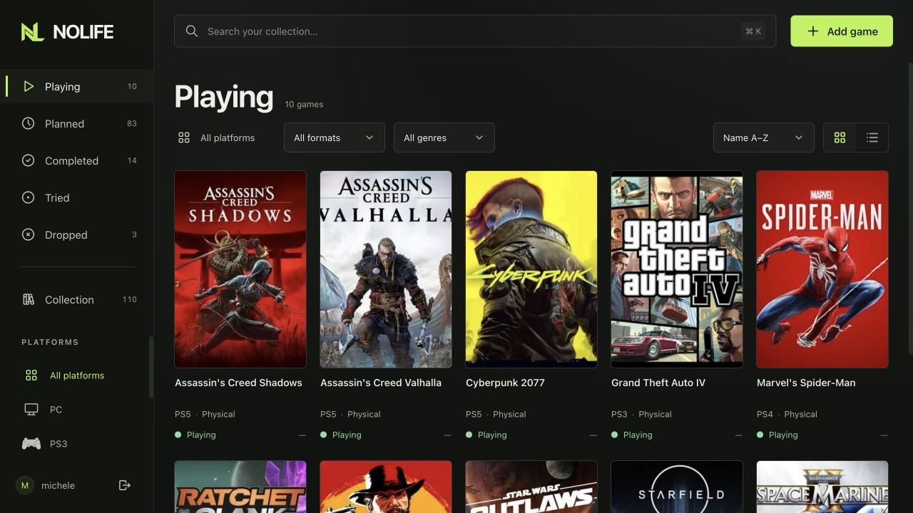

# NoLife

A self-hosted game collection for keeping track of what you are playing, what you have finished, and what you want to play next.



[Website and screenshots](https://nolife.metalogico.dev) · [Installation and operations](docs/installation.md)

## Features

- Playing, Planned, Completed, Tried and Dropped views, plus your full Collection.
- Separate entries for each game, platform and physical or digital format.
- Global search, platform, format and genre filters, and sorting by title, date added or rating.
- Grid and list layouts with automatic pagination and restored scroll position.
- Optional ratings from 1 to 10, expected length and total played time for each copy.
- Manual entry with cover uploads, or IGDB search by title or ID with a preview before importing.
- Local cover art and screenshots, background image selection and an image viewer.
- A responsive English interface with keyboard controls and reduced-motion support.
- One password-protected personal account, persistent SQLite storage, and scheduled database and media backups.

Built with Laravel 13, PHP 8.4, Vue 3, TypeScript, Vite and Tailwind CSS 4. Docker Compose runs the web application, image worker and backup scheduler.

## Install with Docker Compose

Docker image: **`ghcr.io/metalogico/nolife:latest`**

Requires Docker with Compose 2.24.4 or newer. Images support `linux/amd64` and `linux/arm64`.

### Download the configuration

For a new installation:

```sh
mkdir nolife
cd nolife
curl -fL https://raw.githubusercontent.com/metalogico/nolife/main/compose.yaml -o compose.yaml
curl -fL https://raw.githubusercontent.com/metalogico/nolife/main/.env.example -o .env.example
cp .env.example .env
chmod 600 .env
```

Already installed? Keep your `.env` and follow [Updating](#update).

Pull the image:

```sh
docker compose pull
```

### Configure the account

Generate the application key:

```sh
docker compose run --rm --no-deps --entrypoint php app artisan key:generate --show --no-interaction
```

Copy the `base64:...` value into `APP_KEY` in `.env`. Then generate your password hash; the command asks for the password twice, with hidden input. Use at least 12 characters.

```sh
docker compose run --rm --no-deps --entrypoint php app artisan nolife:password
```

Set `NOLIFE_USERNAME` to your chosen username. Copy the entire `NOLIFE_PASSWORD_HASH='...'` line into `.env`, including its single quotes, so Compose preserves the dollar signs in the hash. Keep the key and hash private.

```sh
docker compose up -d --wait
```

Open [localhost:8093](http://localhost:8093) and sign in. The collection starts empty. The default bind address is `127.0.0.1`; LAN access, HTTPS, backups, updates and recovery are covered in the [installation guide](docs/installation.md).

## Use

**Add game** opens IGDB search. Select a result, choose your platform and format, then confirm. **Enter details manually** works without IGDB credentials and supports a cover upload. A new entry uses the current status view; entries added from Collection start as Planned.

Open a game to change its status, rating or playtime. **Edit game** changes its details. **Fetch metadata** previews a new IGDB match before applying it and preserves your platform, format, status, rating and playtime. **Set as header** on a gallery image selects that copy's background.

To enable metadata search, create your own credentials following the [IGDB setup instructions](https://api-docs.igdb.com/#account-creation), then set `IGDB_CLIENT_ID` and `IGDB_CLIENT_SECRET` in `.env` and recreate the containers. Credentials and OAuth tokens stay in the backend. The worker downloads image variants into private local storage; previews may load directly from IGDB.

There is one account configured through `.env`, with no registration or account-management screen. Playtime is entered manually in hours and stored in minutes; an empty value and zero are distinct.

## Data and maintenance

The default Compose project is `sh-nolife`. Its named volumes contain:

| Volume | Contents |
| --- | --- |
| `sh-nolife_data` | SQLite database and its WAL files |
| `sh-nolife_storage` | Images, sessions, cache, logs and the library lock |
| `sh-nolife_backups` | Database and media backup archives |

Container recreation preserves these volumes. Keep a protected copy of `.env`, especially `APP_KEY`. Backups in a named volume are on the Docker host; copy them to a separate disk for recovery from host failure.

```sh
docker compose ps
docker compose logs --tail 50 app worker scheduler
docker compose exec -T --user www-data app php artisan nolife:backup --no-interaction
```

The scheduler runs backups at 03:30 and 15:30 in `APP_TIMEZONE` (Europe/Rome by default). Archives are retained until you remove them. See the [operations guide](docs/installation.md#backup-and-restore) for export, verification and recovery.

## Update

Create and verify a backup before updating. Stop the app, worker and scheduler before applying migrations:

```sh
docker compose pull
docker compose stop
docker compose up -d --wait
```

Keep the same `.env`, Compose project, data and override files. If you pinned an image version, change its reference in `.env` before pulling. See [UPGRADING.md](docs/UPGRADING.md) for recovery and migration details.

## Development

See [Development](docs/RELEASING.md#local-checks-before-merging) for source builds and local tests.

## Credits and licensing

The NoLife application is licensed under the [MIT License](LICENSE).

Game artwork and metadata belong to their respective providers and rights holders.

Platform assets retain the RomM source revision and upstream notices in [public/platforms/ATTRIBUTIONS](public/platforms/ATTRIBUTIONS) and [LICENSE.romm.txt](public/platforms/LICENSE.romm.txt). Platform assets and other third-party packages retain their own licenses.
